# egress-guard

根据**本机公网出口 IP** 自动控制选中应用的联网：

- 出口 IP 命中白名单 → 放行
- 出口 IP 不在白名单内（或检测失败）→ 用 **WFP（Windows Filtering Platform）** 阻断这些应用的全部网络连接
- 可选**全局断网**：出口 IP 不在白名单时切断本机全部网络，只保留必要的例外（本工具、回环、DHCP，以及可选的局域网、DNS、VPN 客户端和 VPN 服务器地址）

Rust 编写，只用 WFP 用户态 API（`fwpuclnt.dll`），**不需要安装驱动**。

另有 **macOS 版**（全局断网用系统自带的 pf 防火墙；按应用断网用网络扩展，需要 Developer ID 签名版本），见下文 [macOS 版](#macos-版)。

Windows 版提供两个程序：

| 程序 | 用途 |
| --- | --- |
| `egress-guard-gui.exe` | 图形界面 + 系统托盘（推荐日常使用）。启动时自动请求管理员权限。 |
| `egress-guard.exe` | 命令行版本，适合脚本或服务化部署。 |

| 浅色 | 深色 |
| --- | --- |
| 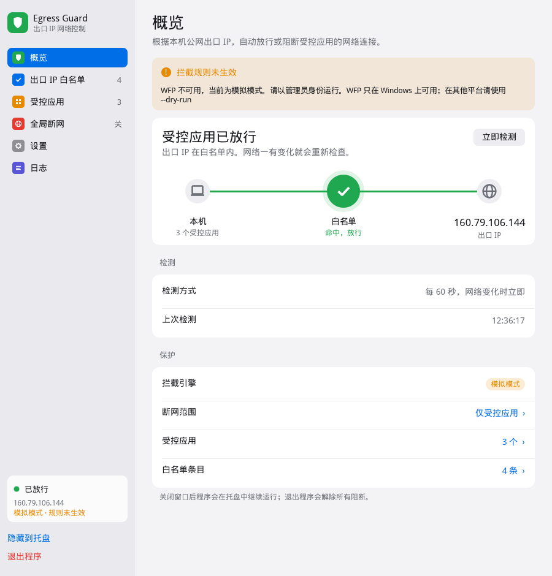 | 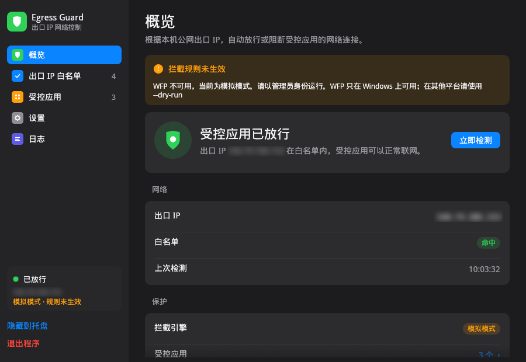 |
| 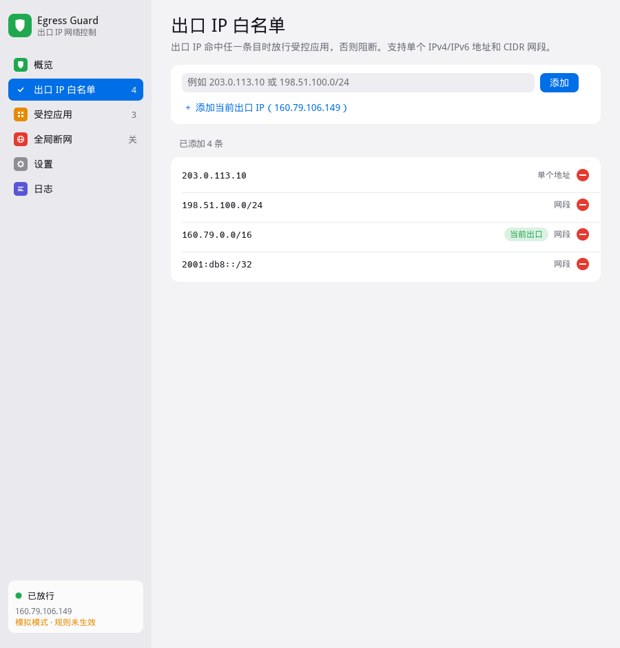 | 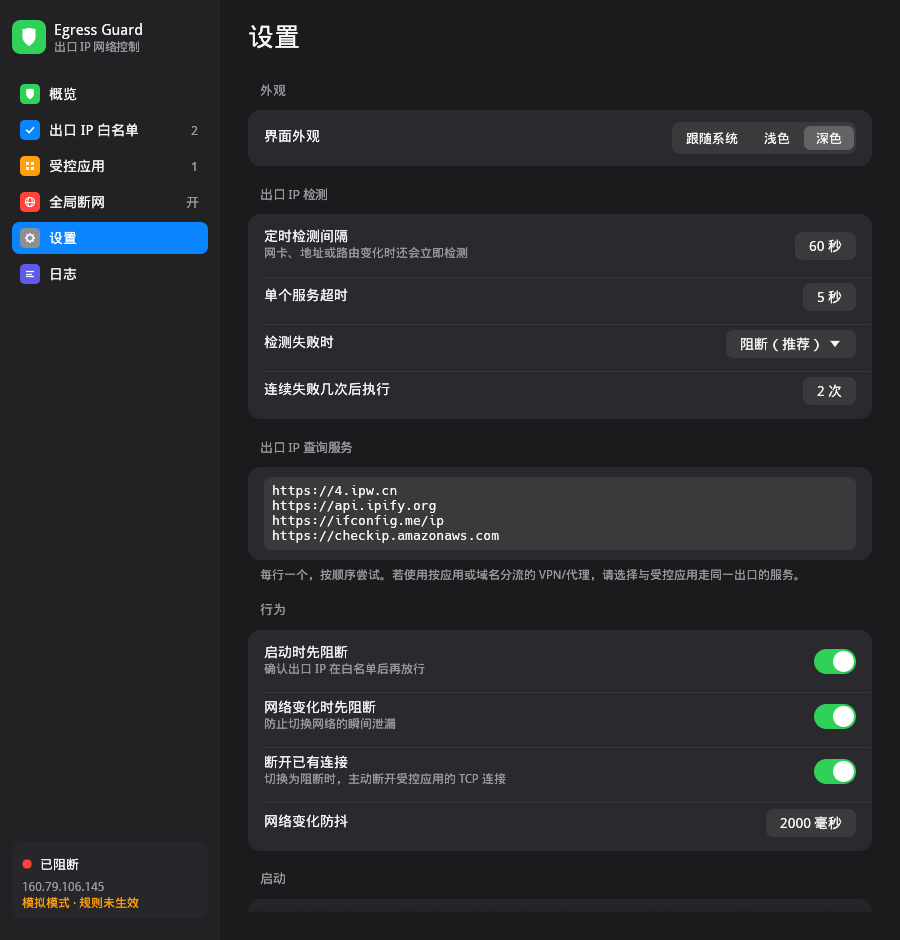 |
| 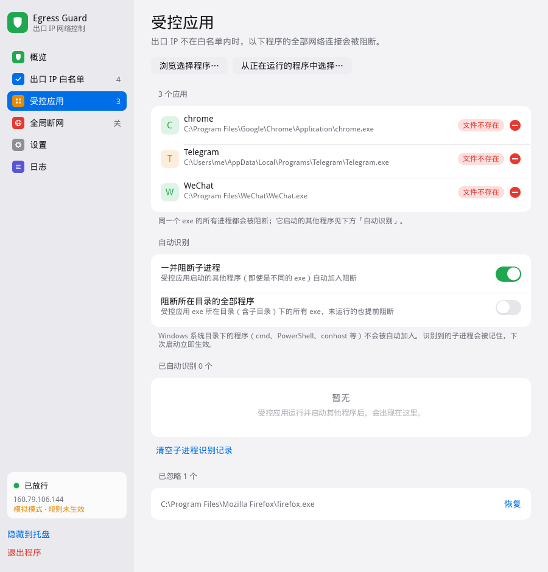 | 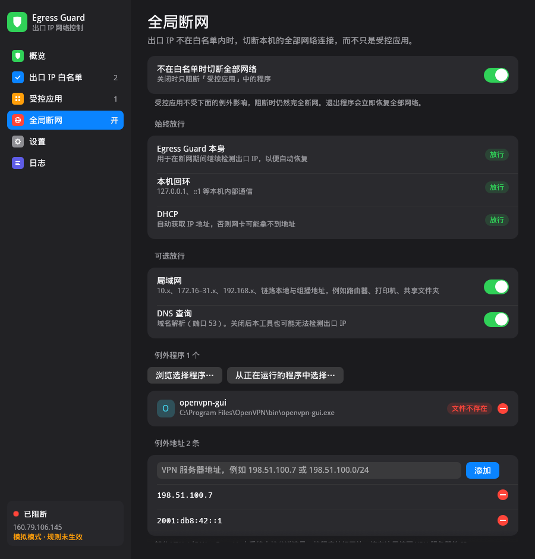 |

界面采用苹果风格：左侧边栏导航、大标题、分组圆角卡片、iOS 式开关，浅色/深色可在 **设置 → 外观** 中切换（默认跟随系统）。概览页用一条"出口通路"（本机 ─ 白名单闸门 ─ 互联网）直观显示当前是放行还是阻断。点窗口的 × 会隐藏到托盘，右键托盘图标可以退出程序。动效保持克制（导航高亮滑动、页面淡入、按钮悬停与按下、状态切换），Windows 关闭了"动画效果"时不播放。

## 工作原理

| 部分 | 实现 |
| --- | --- |
| 拦截 | `FwpmEngineOpen0` 打开**动态会话**（`FWPM_SESSION_FLAG_DYNAMIC`），在自建的最高权重子层里，按应用 ID（`FwpmGetAppIdFromFileName0` + `FWPM_CONDITION_ALE_APP_ID`）在 `ALE_AUTH_CONNECT` / `ALE_AUTH_RECV_ACCEPT` 的 v4/v6 四个层添加 Block 过滤器（带 `CLEAR_ACTION_RIGHT`，硬阻断）。TCP、UDP、IPv4、IPv6 都覆盖。 |
| 规则自动失效 | 动态会话的规则在进程退出、崩溃或被结束时由系统自动删除，不会残留导致应用永久断网。 |
| 切断已有连接 | 切换到阻断时，额外用 `SetTcpEntry(DELETE_TCB)` 断开受控应用已建立的 IPv4 TCP 连接，让应用立即感知断网。 |
| 出口 IP 检测 | 定时（默认 60 秒）依次查询配置的公网 IP 服务，取第一个成功结果；同时用 `NotifyIpInterfaceChange` / `NotifyUnicastIpAddressChange` / `NotifyRouteChange2` 监听网卡、地址、路由变化，变化后防抖 2 秒立即重新检测。 |
| 防泄漏 | 默认启动时先阻断；网络变化时也先阻断，确认新出口 IP 在白名单后再放行。 |
| 子进程 | 每秒扫描进程树，受控应用启动的子进程（即使是不同的 exe，含多级后代）自动加入阻断，并记录到 `learned-apps.txt`。用进程创建时间排除 PID 复用误判；`%WINDIR%` 下的系统程序不会被加入。可选同时阻断受控应用所在目录下的全部 exe。规则增量更新，没有放行空档。 |
| 全局断网 | 开启后阻断时额外添加一条不带条件的兜底 Block 过滤器（四个层，`CLEAR_ACTION_RIGHT`）和若干 Permit 例外：本工具自身（按应用 ID）、回环（`FWP_CONDITION_FLAG_IS_LOOPBACK`）、DHCP（UDP 本地端口 68/546），以及可选的局域网网段、DNS（远端端口 53）、例外程序和例外地址。同一子层内按权重裁决：受控应用阻断 15 > 例外放行 8 > 兜底阻断 0，所以受控应用不享受这些例外。切换时同样断开非例外的 IPv4 TCP 连接。 |
| 白名单 | 单个 IPv4/IPv6 地址或 CIDR 网段（如 `198.51.100.0/24`、`2001:db8::/32`）。 |

## 快速开始（图形界面）

1. 把 `egress-guard-gui.exe` 放到一个固定目录（例如 `C:\Tools\egress-guard\`），双击运行，在 UAC 提示中选"是"。
2. 侧边栏 **出口 IP 白名单**：输入 IP 或 CIDR 后点"添加"，或直接点"添加当前出口 IP"。
3. 侧边栏 **受控应用**：点"浏览选择程序…"，或"从正在运行的程序中选择…"。它启动的子进程会被自动识别并一起阻断（可在同一页关闭，或对单个程序点"忽略"）。
4. 有修改时底部会出现保存栏，点"保存并应用"。配置写入 exe 同目录的 `config.toml`，并立即生效。
5. **概览** 页显示当前状态：红色 **已阻断** / 绿色 **已放行**，以及出口 IP、白名单是否命中、上次检测时间、拦截引擎状态。

托盘与退出：

- 点窗口右上角的 × 会隐藏到托盘，程序继续在后台保护；右键托盘图标选「退出程序」才会真正退出。托盘图标颜色表示状态：绿色为放行，红色为阻断，灰色为检测中，黄色为模拟模式（规则未生效）。
- 单击或双击托盘图标可以打开窗口；右键菜单里有"立即检测"和"退出"。
- **退出程序后，所有阻断规则会被移除。**
- 再次双击 exe 不会启动第二个实例，只会把已有的窗口调出来。

开机自启：在 **设置** 页勾选"登录 Windows 时自动启动"。程序会注册一个任务计划程序任务，登录后以最高权限在托盘中启动，不弹出 UAC。任务不限运行时长，用电池时也会运行。

日志在 **日志** 页查看，同时写入 exe 同目录的 `egress-guard.log`，每次启动时覆盖。

如果概览页显示"拦截规则未生效"，说明 WFP 打开失败（通常是因为没有以管理员身份运行）。这时程序处于模拟模式，**不会真正阻断**。

## 命令行版本

```powershell
.\egress-guard.exe check            # 校验配置、检查应用路径（不需要管理员）
.\egress-guard.exe ip               # 检测一次出口 IP（不需要管理员）
.\egress-guard.exe run --dry-run    # 只打印决策，不改动网络（不需要管理员）
.\egress-guard.exe run              # 正式运行，需要管理员终端，Ctrl+C 退出
```

常用参数：`-c <配置文件路径>`、`--log-level debug`。命令行版本和界面版本使用同一种 `config.toml` 格式，但不要同时运行两者。

如果要让命令行版本开机自启，可以在管理员 PowerShell 中注册计划任务（路径按实际修改）：

```powershell
$exe = "C:\Tools\egress-guard\egress-guard.exe"
$action   = New-ScheduledTaskAction -Execute $exe -Argument "run" -WorkingDirectory (Split-Path $exe)
$trigger  = New-ScheduledTaskTrigger -AtLogOn
$settings = New-ScheduledTaskSettingsSet -ExecutionTimeLimit 0 -AllowStartIfOnBatteries -DontStopIfGoingOnBatteries
Register-ScheduledTask -TaskName "egress-guard-cli" -Action $action -Trigger $trigger -Settings $settings -RunLevel Highest
```

## 配置说明

见 `config.example.toml`，每一项都有注释。要点：

- `apps` 写 exe 完整路径，TOML 里用单引号就不用转义反斜杠。应用文件必须存在（WFP 根据文件路径生成应用 ID）。
- `detect.fail_mode`：检测失败时 `block`（默认）/ `allow` / `keep`，在连续失败 `failure_threshold` 次后生效。
- `detect.services`：任意返回包含 IP 文本的 HTTPS 地址都可以。
- `[block_all]`：全局断网，界面里在 **全局断网** 页设置。默认放行局域网和 DNS。

## 注意事项与已知限制

- **分流 VPN / 代理**：工具检测的是"本工具访问 IP 服务时"的出口。若用了按域名/应用分流，受控应用实际出口可能不同，请选择与受控应用走同一路线的 IP 服务。
- 本工具发出的 IP 检测请求读取 `HTTPS_PROXY` 环境变量，不读取 Windows 系统代理设置。
- 阻断同样会切断受控应用到本机（127.0.0.1）的连接，例如连接本地代理端口。
- 动态会话意味着**结束本进程即解除阻断**。如果需要"即使工具被关掉也保持阻断"，需要改为持久化规则（后续可选）。
- 主动断开已有连接只支持 IPv4 TCP（Windows API 限制）；其他已有流量依赖 WFP 在过滤器变更后的重新授权。
- **全局断网**期间 VPN 想要重连，需要把 VPN 客户端加入例外程序；WireGuard 等由系统内核发包的 VPN 按程序放行无效，需要把 VPN 服务器 IP 加入例外地址。白名单为空时开启全局断网，本机会一直断网直到退出程序。
- 全局断网放行 DNS 时，域名查询本身仍可能经非白名单出口发出；对此敏感可以关闭，但本工具的出口 IP 检测也需要 DNS，关闭后可能一直无法恢复（除非 DNS 走局域网）。
- 同一时间只能运行一个实例（固定子层 GUID，第二个实例会提示已存在）。
- 界面保存配置时会重写 `config.toml`，手写的注释不会保留。
- 子进程识别靠每秒一次的进程快照：新出现的子进程在被识别前（约 1 秒内）可能已发出少量连接。识别结果会被记住，之后再启动就从第一刻起被阻断；对安全要求高的应用可以再开启"阻断所在目录的全部程序"，提前覆盖尚未运行的辅助程序。
- 如果受控应用调起了浏览器等本不想阻断的程序，它也会被识别为子进程，在"受控应用"页点"忽略"即可。

## macOS 版

macOS 版与 Windows 版共用同一套检测、决策逻辑和界面（苹果风格侧边栏、浅色/深色、克制动效），配置格式相同。差别在拦截方式：

| | Windows | macOS |
| --- | --- | --- |
| 拦截机制 | WFP（按应用 ID） | 全局断网：pf 防火墙；按应用断网：网络扩展（内容过滤） |
| 按应用断网 | ✅ | ⚠️ 已实现，但需要 Developer ID 签名版本才能启用（见下方说明） |
| 全局断网 | ✅ | ✅ 局域网、DNS、DHCP、IPv6 邻居发现、例外地址照常放行 |
| 例外程序（如 VPN 客户端） | ✅ | ❌ 请把 VPN 服务器 IP 填到「例外地址」 |
| 权限 | 界面以管理员身份运行 | 界面以普通用户运行；拦截由 root 后台服务（launchd）负责 |
| 托盘 | 系统托盘 | 菜单栏图标（不占程序坞） |
| 开机自启 | 任务计划程序 | 后台服务开机即保护 + 登录后在菜单栏显示 |
| 需要签名吗 | 不需要 | 全局断网不需要（ad-hoc 签名即可运行）；按应用断网需要 |

<p>
  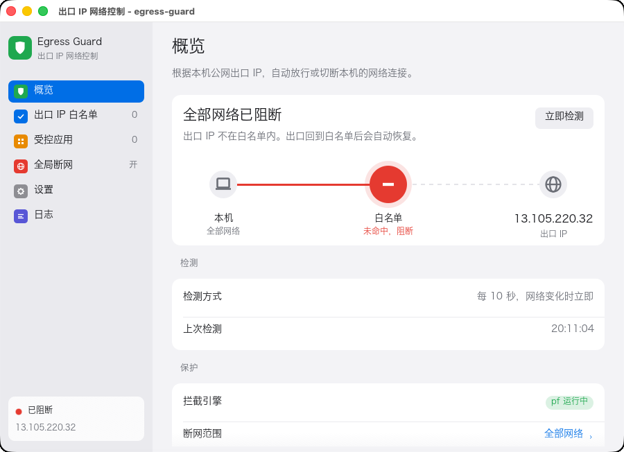
  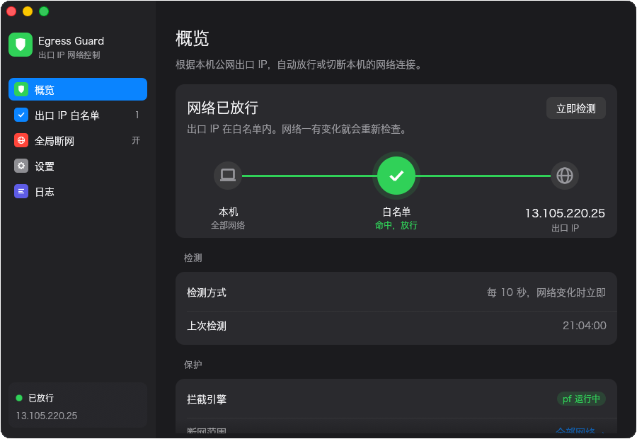
</p>
<p>
  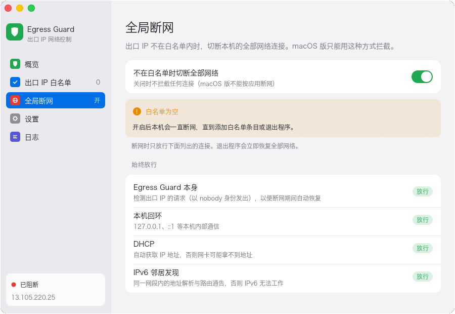
  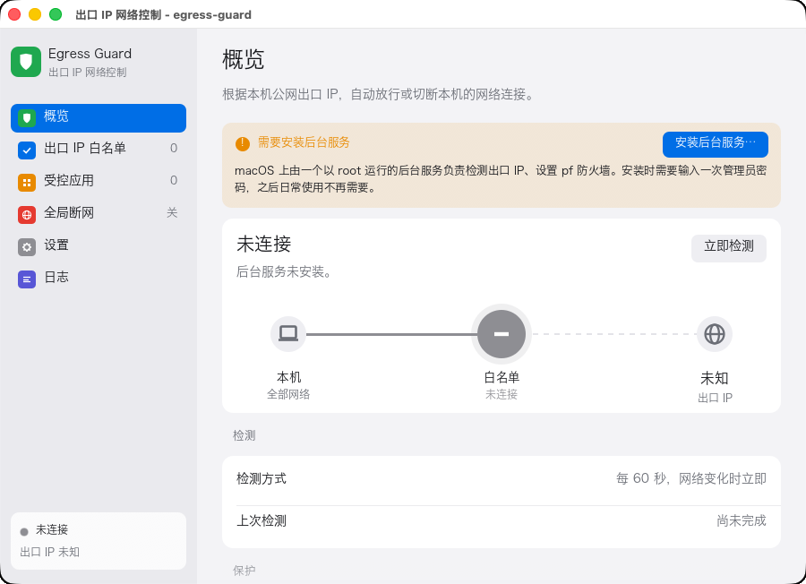
</p>

以上截图来自 GitHub Actions 的 macOS 虚拟机，CI 每次都会真实安装后台服务并验证断网与恢复。菜单栏图标：

### 按应用断网（网络扩展）

pf 只认地址、端口和用户，分不清是哪个应用发出的连接。macOS 上能按应用拦截的官方机制是 **Network Extension 内容过滤（NEFilterDataProvider 系统扩展）**，Little Snitch、LuLu 都用它。0.7.0 起 .app 里带有这样一个网络扩展：后台服务把「是否阻断 + 受控应用列表（含自动识别的子进程）」推送给它，它对受控应用的连接逐个放行或丢弃。

**但 macOS 只加载用付费 Apple Developer ID 签名、带描述文件并经过公证的网络扩展。** 发布的 zip 没有签名，「受控应用」页会说明这一点，点「仍要尝试启用」会显示系统拒绝的原因；在那之前请用「全局断网」。拿到开发者账号后怎么签名、用户怎么启用、以及第一次在真机上需要验证什么，见 [docs/macos-network-extension.md](docs/macos-network-extension.md)。

<p>
  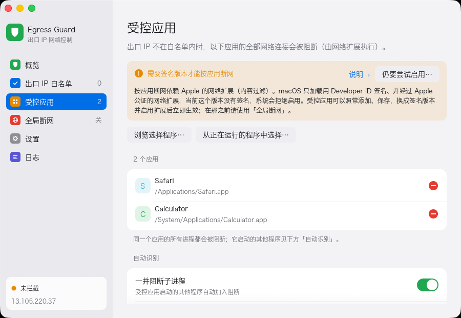
  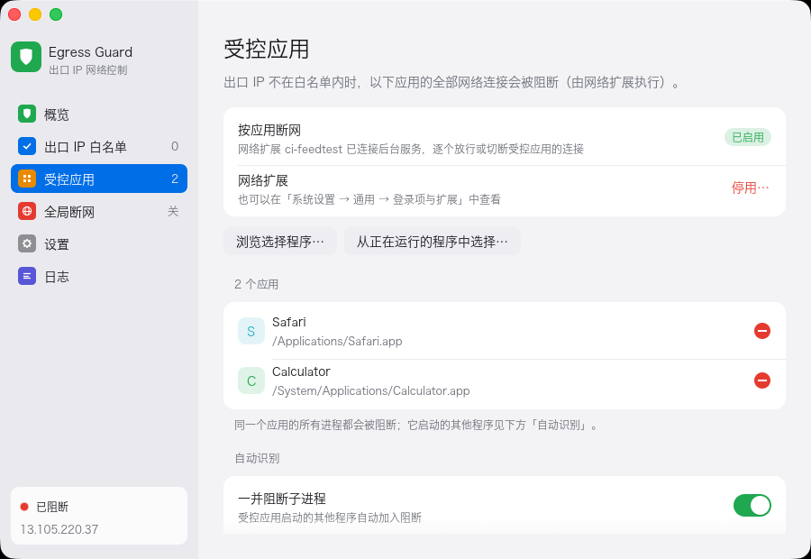
</p>

右图来自 CI：没有签名的扩展无法真正加载，图中「已连接」的是用扩展里同一份通信代码写的测试客户端，用来验证后台服务与扩展之间的协议。

### 安装与使用

1. 下载 `egress-guard-<版本>-macos.zip`，解压后把 **Egress Guard.app** 拖到「应用程序」文件夹（Apple 芯片和 Intel 都可以用）。
2. 第一次打开：因为没有 Apple 公证，系统会提示"无法验证开发者"。在 Finder 里右键 → 打开；macOS 15 起需要到「系统设置 → 隐私与安全性」底部点"仍要打开"。也可以在终端执行 `xattr -dr com.apple.quarantine "/Applications/Egress Guard.app"`。
3. 概览页点 **安装后台服务…**，输入一次管理员密码。之后修改设置、开机自启都不再需要密码（修改设置要求当前用户是管理员）。
4. **出口 IP 白名单** 页添加当前出口 IP；**全局断网** 页打开"不在白名单时切断全部网络"，按需保留局域网、DNS，并把 VPN 服务器地址加入例外地址。底部点"保存并应用"。

菜单栏图标颜色与 Windows 托盘相同：绿色放行，红色阻断，灰色检测中/未连接，黄色表示规则没有真正生效（模拟模式，或者全局断网没开、出口 IP 不在白名单也不会断网）。点关闭按钮只是隐藏窗口；菜单栏图标里选「退出并解除阻断」会让后台服务移除全部规则并停止，下次打开界面时服务会自动重新启动。

**更新到新版本**不需要先卸载后台服务：菜单栏图标里选「退出并解除阻断」，把新的 Egress Guard.app 拖进「应用程序」替换旧的，再打开。界面发现后台服务的版本和自己不一样时，概览页顶部会出现「后台服务需要更新」，点 **更新后台服务…** 输入一次密码即可；白名单、受控应用等配置和「开机自动启动」设置都会保留。

### macOS 工作原理

| 部分 | 实现 |
| --- | --- |
| 后台服务 | `/Library/LaunchDaemons/com.egressguard.daemon.plist`，以 root 运行 `/Library/Application Support/EgressGuard/bin/egress-guard daemon`（安装时从 .app 里复制，移动或删除 .app 不影响已安装的服务）。配置在同目录的 `config.toml`，日志在 `/Library/Logs/egress-guard.log`。 |
| 界面通信 | launchd 创建的本地套接字 `/var/run/egress-guard.sock`，每行一个 JSON。界面连接时服务按需启动；只读请求所有用户可用，修改设置只接受 root 和管理员组。 |
| 按应用断网 | 网络扩展（`com.egressguard.app.filter`，root）连接上面的套接字接收规则，逐个连接放行或丢弃，详见 [docs/macos-network-extension.md](docs/macos-network-extension.md)。服务运行期间存在 `/var/run/egress-guard.running`，扩展只在它存在时连接，避免「退出」后被扩展重新拉起。 |
| 全局断网 | 规则装入 `com.apple/egress-guard` 子锚点（系统默认的 `/etc/pf.conf` 已经引用 `com.apple/*`，不修改系统文件）。阻断时用 `pfctl -E` 取得启用令牌，放行时 `pfctl -X` 归还，不影响 pf 原本是否开启。 |
| 断网期间检测出口 IP | 检测在以 `nobody` 身份运行的子进程里进行，pf 规则按套接字所属用户（`user nobody`）放行它，而不是放行全部 root 进程。 |
| 已有连接 | 例外规则不建立状态，兜底规则直接丢弃，所以开始阻断前已经建立的连接在下一个数据包就会被拦截，同时局域网等例外连接不受影响。 |
| 网络变化 | 监听路由套接字（地址增删、网卡状态、非主机路由变化），忽略 AirDrop 等频繁开关的 awdl/llw 接口；变化后与 Windows 一样先阻断、防抖后重新检测。 |
| 异常退出 | pf 规则不会随进程消失：服务崩溃时 launchd 会重启它，启动时先清空残留规则。紧急情况下可以执行 `sudo "/Applications/Egress Guard.app/Contents/MacOS/egress-guard" unblock`。 |

命令行（在 `Egress Guard.app/Contents/MacOS/` 里）：

```bash
egress-guard status              # 后台服务状态（JSON）
egress-guard apply my.toml       # 把配置交给后台服务，立即生效
egress-guard check-now           # 立即检测出口 IP
egress-guard stop                # 移除全部规则并停止服务
sudo egress-guard service install    # 安装 / 更新后台服务
sudo egress-guard service uninstall  # 卸载（保留配置）
sudo egress-guard unblock        # 紧急恢复：清空 pf 规则
```

卸载：设置页"后台服务 → 卸载…"，输入管理员密码。它会停止后台服务、移除全部 pf 规则、删除 `/Library/LaunchDaemons/com.egressguard.daemon.plist` 和服务程序，并关闭登录时自动打开，网络立即恢复原样；之后把 .app 拖进废纸篓即可。配置文件会保留在 `/Library/Application Support/EgressGuard`，重新安装后沿用；不需要的话可以手动删除这个文件夹和日志 `/Library/Logs/egress-guard*.log`。没有界面时也可以在终端执行 `sudo "/Applications/Egress Guard.app/Contents/MacOS/egress-guard" service uninstall`。

## 从源码构建

```powershell
# Windows 上（需要 Rust 工具链，MSVC 或 GNU 均可）
cargo build --release
# 产物：target\release\egress-guard.exe 和 egress-guard-gui.exe
```

在 Linux 上交叉编译：

```bash
rustup target add x86_64-pc-windows-gnu
sudo apt install gcc-mingw-w64-x86-64
cargo build --release --target x86_64-pc-windows-gnu
```

macOS（需要 Xcode 命令行工具和 Rust）：

```bash
scripts/macos/bundle.sh              # 本机架构，生成 target/macos/Egress Guard.app 和 zip（含网络扩展，ad-hoc 签名）
scripts/macos/bundle.sh --universal  # Apple 芯片 + Intel 通用版本
```

单元测试（白名单匹配、IP 解析、决策逻辑、pf 规则生成、本地通信协议）可在任意平台运行：`cargo test`。

CI（`.github/workflows/ci.yml`）在 Linux、Windows、macOS 上测试和构建；macOS 任务还会编译网络扩展、运行它的 Swift 单元测试，并在 GitHub 的 Mac 虚拟机上安装后台服务，实际验证全局断网、例外地址、白名单放行、退出恢复，以及后台服务向网络扩展推送规则的协议（`scripts/macos/ci-e2e.sh`）。

## 代码结构

```
src/
  bin/cli.rs        命令行入口（macOS 上也是后台服务和管理工具）
  bin/gui.rs        界面入口（单实例、--minimized）
  engine.rs         后台引擎线程：定时检测、网络变化、配置热更新、退出
  daemon.rs         后台服务：运行引擎 + 本地套接字（macOS）
  ipc.rs            界面、网络扩展与后台服务的通信协议（JSON 行）
  filterfeed.rs     推送给 macOS 网络扩展的按应用阻断规则
  netext.rs         界面调用的网络扩展安装/开关（macOS，Swift 桥接）
  pfrules.rs        pf 规则文本生成（与平台无关，可测试）
  config.rs         TOML 配置解析/保存、白名单（IP/CIDR）匹配
  egress.rs         公网出口 IP 查询（ureq + 系统 TLS）
  controller.rs     阻断/放行决策逻辑，Firewall 抽象，dry-run 后端
  blockall.rs       全局断网的例外规则（局域网网段、DNS、DHCP 端口）
  discovery.rs      子进程 / 同目录关联程序识别
  logbuf.rs         日志（stderr / 文件 / 界面）
  gui/mod.rs        界面页面（eframe/egui）
  gui/backend.rs    界面背后的引擎：本进程（Windows）或后台服务（macOS）
  gui/theme.rs      苹果风格配色、样式和自绘控件（开关、分段控件、卡片、图标）
  gui/tray.rs       系统托盘（独立消息循环线程）
  gui/tray_mac.rs   macOS 菜单栏图标
  gui/icons.rs      运行时绘制的状态图标
  win/wfp.rs        WFP 动态会话、子层、按应用 ID 的阻断过滤器、全局断网规则
  win/netwatch.rs   网卡/地址/路由变化监听
  win/tcpkill.rs    断开已有的 IPv4 TCP 连接
  win/procs.rs      进程枚举
  win/autostart.rs  任务计划程序开机自启
  mac/firewall.rs   macOS 拦截后端：pf（全局断网）+ 网络扩展（按应用）
  mac/pf.rs         pf 锚点规则、启用令牌
  mac/service.rs    launchd 后台服务安装/卸载、登录项、管理员授权
  mac/netwatch.rs   路由套接字监听网络变化
  mac/procs.rs      进程枚举（libproc）
macos/FilterExtension/  网络扩展（Swift，NEFilterDataProvider）、Info.plist、权限
macos/Shared/       网络扩展与测试共用：规则匹配、连接后台服务
macos/Bridge/       界面调用的网络扩展管理（Swift，编译为静态库）
macos/Tests/        Swift 单元测试与协议测试客户端
assets/             exe 图标、界面程序清单（requireAdministrator）
scripts/macos/      .app 打包、Info.plist、CI 端到端测试
```

在 Linux 上可以预览界面布局（没有托盘和 WFP，会进入模拟模式）：`cargo run --bin egress-guard-gui -- config.toml`。
