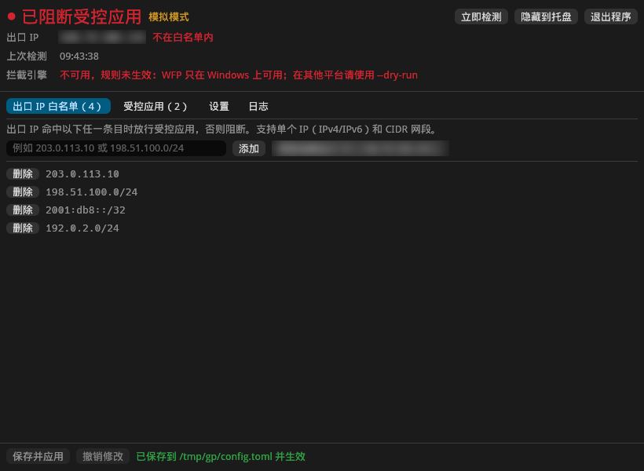

# egress-guard

根据**本机公网出口 IP** 自动控制选中应用的联网：

- 出口 IP 命中白名单 → 放行
- 出口 IP 不在白名单内（或检测失败）→ 用 **WFP（Windows Filtering Platform）** 阻断这些应用的全部网络连接

Rust 编写，只用 WFP 用户态 API（`fwpuclnt.dll`），**不需要安装驱动**。

提供两个程序：

| 程序 | 用途 |
| --- | --- |
| `egress-guard-gui.exe` | 图形界面 + 系统托盘（推荐日常使用）。启动时自动请求管理员权限。 |
| `egress-guard.exe` | 命令行版本，适合脚本或服务化部署。 |



## 工作原理

| 部分 | 实现 |
| --- | --- |
| 拦截 | `FwpmEngineOpen0` 打开**动态会话**（`FWPM_SESSION_FLAG_DYNAMIC`），在自建的最高权重子层里，按应用 ID（`FwpmGetAppIdFromFileName0` + `FWPM_CONDITION_ALE_APP_ID`）在 `ALE_AUTH_CONNECT` / `ALE_AUTH_RECV_ACCEPT` 的 v4/v6 四个层添加 Block 过滤器（带 `CLEAR_ACTION_RIGHT`，硬阻断）。TCP、UDP、IPv4、IPv6 都覆盖。 |
| 规则自动失效 | 动态会话的规则在进程退出、崩溃或被结束时由系统自动删除，不会残留导致应用永久断网。 |
| 切断已有连接 | 切换到阻断时，额外用 `SetTcpEntry(DELETE_TCB)` 断开受控应用已建立的 IPv4 TCP 连接，让应用立即感知断网。 |
| 出口 IP 检测 | 定时（默认 60 秒）依次查询配置的公网 IP 服务，取第一个成功结果；同时用 `NotifyIpInterfaceChange` / `NotifyUnicastIpAddressChange` / `NotifyRouteChange2` 监听网卡、地址、路由变化，变化后防抖 2 秒立即重新检测。 |
| 防泄漏 | 默认启动时先阻断；网络变化时也先阻断，确认新出口 IP 在白名单后再放行。 |
| 白名单 | 单个 IPv4/IPv6 地址或 CIDR 网段（如 `198.51.100.0/24`、`2001:db8::/32`）。 |

## 快速开始（图形界面）

1. 把 `egress-guard-gui.exe` 放到一个固定目录（例如 `C:\Tools\egress-guard\`），双击运行，在 UAC 提示中选"是"。
2. **出口 IP 白名单**页：输入 IP 或 CIDR 后点"添加"，或直接点"添加当前出口 IP"。
3. **受控应用**页：点"浏览选择 exe…"，或"从正在运行的程序中选择…"。
4. 点底部的"保存并应用"。配置写入 exe 同目录的 `config.toml`，并立即生效。
5. 顶部会显示当前状态：红色 **已阻断** / 绿色 **已放行**，以及出口 IP、上次检测时间、拦截引擎状态。

托盘与退出：

- 点窗口右上角的关闭按钮，或点"隐藏到托盘"，程序会继续在后台保护。托盘图标颜色表示状态：绿色为放行，红色为阻断，灰色为检测中，黄色为模拟模式（规则未生效）。
- 单击或双击托盘图标可以打开窗口；右键菜单里有"立即检测"和"退出"。
- **退出程序后，所有阻断规则会被移除。**
- 再次双击 exe 不会启动第二个实例，只会把已有的窗口调出来。

开机自启：在 **设置** 页勾选"登录 Windows 时自动启动"。程序会注册一个任务计划程序任务，登录后以最高权限在托盘中启动，不弹出 UAC。任务不限运行时长，用电池时也会运行。

日志在 **日志** 页查看，同时写入 exe 同目录的 `egress-guard.log`，每次启动时覆盖。

如果顶部显示"拦截引擎不可用"，说明 WFP 打开失败（通常是因为没有以管理员身份运行）。这时程序处于模拟模式，**不会真正阻断**。

## 命令行版本

```powershell
.\egress-guard.exe check            # 校验配置、检查应用路径（不需要管理员）
.\egress-guard.exe ip               # 检测一次出口 IP（不需要管理员）
.\egress-guard.exe run --dry-run    # 只打印决策，不改动网络（不需要管理员）
.\egress-guard.exe run              # 正式运行，需要管理员终端，Ctrl+C 退出
```

常用参数：`-c <配置文件路径>`、`--log-level debug`。命令行版本和界面版本使用同一种 `config.toml` 格式，但不要同时运行两者。

如果要让命令行版本开机自启，可以在管理员 PowerShell 中注册计划任务（路径按实际修改）：

```powershell
$exe = "C:\Tools\egress-guard\egress-guard.exe"
$action   = New-ScheduledTaskAction -Execute $exe -Argument "run" -WorkingDirectory (Split-Path $exe)
$trigger  = New-ScheduledTaskTrigger -AtLogOn
$settings = New-ScheduledTaskSettingsSet -ExecutionTimeLimit 0 -AllowStartIfOnBatteries -DontStopIfGoingOnBatteries
Register-ScheduledTask -TaskName "egress-guard-cli" -Action $action -Trigger $trigger -Settings $settings -RunLevel Highest
```

## 配置说明

见 `config.example.toml`，每一项都有注释。要点：

- `apps` 写 exe 完整路径，TOML 里用单引号就不用转义反斜杠。应用文件必须存在（WFP 根据文件路径生成应用 ID）。
- `detect.fail_mode`：检测失败时 `block`（默认）/ `allow` / `keep`，在连续失败 `failure_threshold` 次后生效。
- `detect.services`：任意返回包含 IP 文本的 HTTPS 地址都可以。

## 注意事项与已知限制

- **分流 VPN / 代理**：工具检测的是"本工具访问 IP 服务时"的出口。若用了按域名/应用分流，受控应用实际出口可能不同，请选择与受控应用走同一路线的 IP 服务。
- 本工具发出的 IP 检测请求读取 `HTTPS_PROXY` 环境变量，不读取 Windows 系统代理设置。
- 阻断同样会切断受控应用到本机（127.0.0.1）的连接，例如连接本地代理端口。
- 动态会话意味着**结束本进程即解除阻断**。如果需要"即使工具被关掉也保持阻断"，需要改为持久化规则（后续可选）。
- 主动断开已有连接只支持 IPv4 TCP（Windows API 限制）；其他已有流量依赖 WFP 在过滤器变更后的重新授权。
- 同一时间只能运行一个实例（固定子层 GUID，第二个实例会提示已存在）。
- 界面保存配置时会重写 `config.toml`，手写的注释不会保留。
- 受控应用如果启动了其他路径的子进程（如更新器、辅助进程），需要把这些 exe 也加入 `apps`。

## 从源码构建

```powershell
# Windows 上（需要 Rust 工具链，MSVC 或 GNU 均可）
cargo build --release
# 产物：target\release\egress-guard.exe 和 egress-guard-gui.exe
```

在 Linux 上交叉编译：

```bash
rustup target add x86_64-pc-windows-gnu
sudo apt install gcc-mingw-w64-x86-64
cargo build --release --target x86_64-pc-windows-gnu
```

单元测试（白名单匹配、IP 解析、决策逻辑）可在任意平台运行：`cargo test`。

## 代码结构

```
src/
  bin/cli.rs        命令行入口
  bin/gui.rs        界面入口（单实例、--minimized）
  engine.rs         后台引擎线程：定时检测、网络变化、配置热更新、退出
  config.rs         TOML 配置解析/保存、白名单（IP/CIDR）匹配
  egress.rs         公网出口 IP 查询（ureq + 系统 TLS）
  controller.rs     阻断/放行决策逻辑，Firewall 抽象，dry-run 后端
  logbuf.rs         日志（stderr / 文件 / 界面）
  gui/mod.rs        界面（eframe/egui）
  gui/tray.rs       系统托盘（独立消息循环线程）
  gui/icons.rs      运行时绘制的状态图标
  win/wfp.rs        WFP 动态会话、子层、按应用 ID 的阻断过滤器
  win/netwatch.rs   网卡/地址/路由变化监听
  win/tcpkill.rs    断开受控应用已有的 IPv4 TCP 连接
  win/procs.rs      进程枚举
  win/autostart.rs  任务计划程序开机自启
assets/             exe 图标、界面程序清单（requireAdministrator）
```

在 Linux 上可以预览界面布局（没有托盘和 WFP，会进入模拟模式）：`cargo run --bin egress-guard-gui -- config.toml`。
