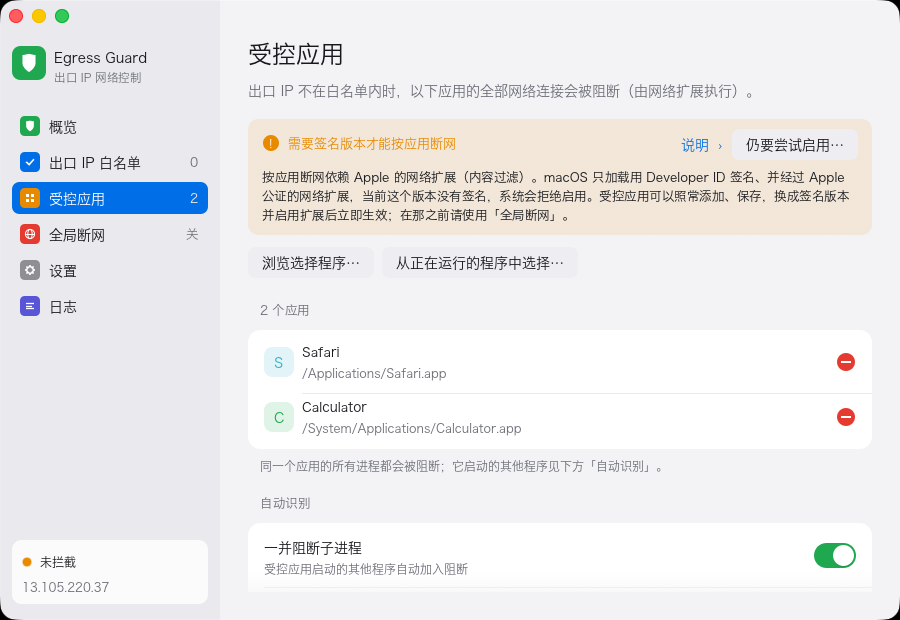
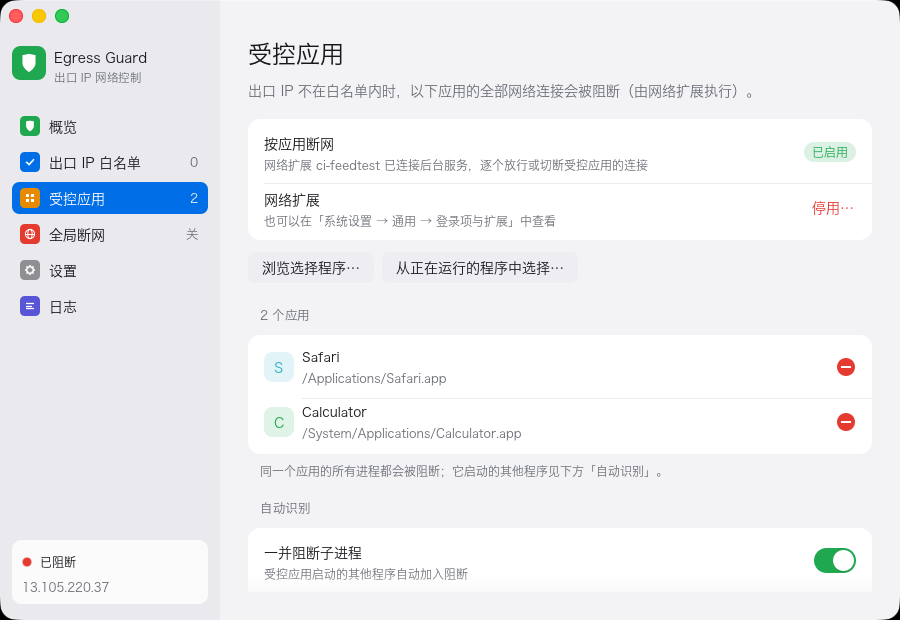
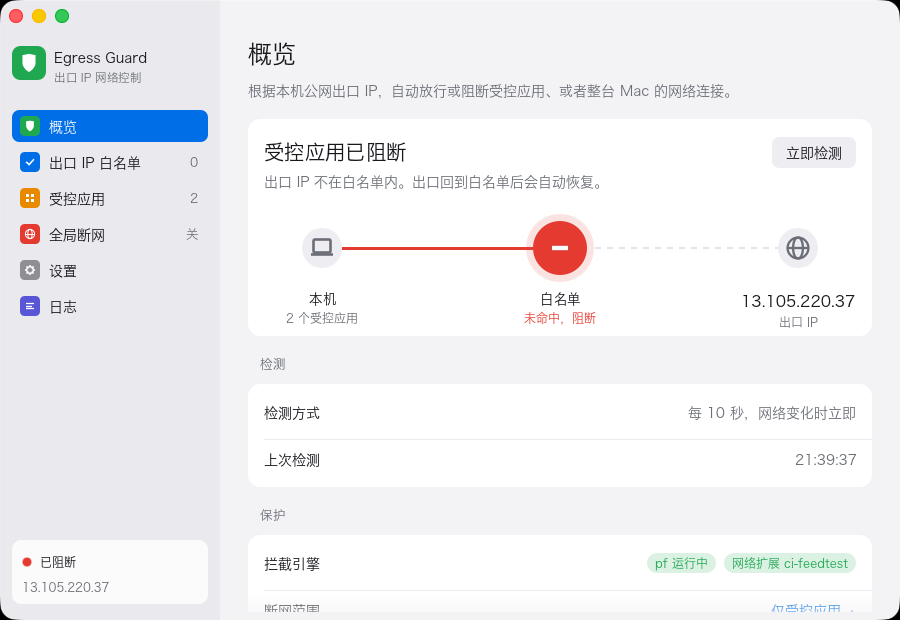

# macOS 按应用断网：网络扩展

macOS 版从 0.7.0 起带有一个 **网络扩展**（Network Extension 的内容过滤系统扩展，和 Little Snitch、LuLu 用的是同一种机制），用来像 Windows 版一样只切断「受控应用」的网络连接，而不必切断整台 Mac 的网络。

> **现状（请先读这一段）**
>
> - 代码已经完整：网络扩展、界面里的启用流程、后台服务向扩展推送规则，都已经写好并在 CI 里编译通过。
> - **但是 macOS 只会加载用付费 Apple Developer ID 签名、带描述文件、并经过 Apple 公证的网络扩展。** 现在发布的 zip 是未签名（ad-hoc）的，所以在任何一台正常的 Mac 上点「启用网络扩展」都会被系统拒绝，界面会显示系统返回的原因。
> - 因此 **按应用断网这部分还没有在真机上运行过**。CI 能验证的是：Swift 代码能编译、规则匹配逻辑、扩展与后台服务之间的通信协议（用同一份代码写的测试客户端连接真实的后台服务）、未签名时系统给出的错误。真正的拦截效果要等有了签名版本才能测。
> - 没有签名之前，「全局断网」（pf）照常可用，不受影响。

在 CI（GitHub 的 macOS 26 虚拟机）里，未签名版本点「启用」时系统返回的是：

```
OSSystemExtensionErrorDomain 2：Missing entitlement com.apple.developer.system-extension.install
```

界面会把它翻译成「程序缺少安装系统扩展的权限：需要用 Developer ID 签名并带上描述文件」。

| 未签名版本 | 扩展已连接（CI 中由测试客户端模拟） | 概览：只阻断受控应用 |
| --- | --- | --- |
|  |  |  |

## 它是怎么工作的

```
界面（普通用户）──安装扩展、开启内容过滤──▶ macOS（系统设置里由用户允许）
     │                                              │
     │ 本地套接字                                   ▼
     ▼                                        网络扩展（root，系统启动）
后台服务（root，launchd）──── 规则：是否阻断 + 受控应用列表 ────▶ 逐个连接：放行 / 丢弃
     │
     └── pf：全局断网
```

| 部分 | 位置 | 说明 |
| --- | --- | --- |
| 网络扩展 | `macos/FilterExtension/`、`macos/Shared/` | Swift。`NEFilterDataProvider` 接管所有 TCP/UDP 新连接，按发起程序的路径判断：受控应用且当前阻断 → 丢弃；其余放行。「断开已有连接」开启时，放行期间受控应用的连接会被持续检查，切换为阻断后在下一个数据包被切断。 |
| 规则来源 | `src/filterfeed.rs`、`src/ipc.rs` | 扩展连接后台服务的 `/var/run/egress-guard.sock`，发送 `filter_watch`，之后持续收到 `{"blocked":…,"inspect_existing":…,"apps":[…]}`。只接受 root 进程；扩展也会核对套接字另一端是 root。 |
| 受控应用匹配 | `macos/Shared/FilterRules.swift` | `.app` 条目匹配包里的所有程序（主程序、Helper 等）；其他条目按可执行文件完整路径匹配；不区分大小写。自动识别到的子进程由后台服务加进列表。 |
| 安装与开关 | `macos/Bridge/NetExtBridge.swift` | 编译成静态库链接进界面程序。调用 `OSSystemExtensionRequest` 安装扩展、`NEFilterManager` 开启内容过滤。 |
| 服务退出时 | | 服务退出前推送「放行」，并删除 `/var/run/egress-guard.running`。扩展只在这个文件存在时才连接（否则连接本身会让 launchd 把服务重新拉起来）；文件不在时放行全部连接。服务崩溃时文件还在，扩展保留最后的规则并重连，launchd 也会重启服务。 |

## 需要准备什么（Apple Developer 账号）

1. **加入 Apple Developer Program**（个人或公司，每年 99 美元）。记下 **团队 ID**（Team ID，10 位，例如 `ABCDE12345`），在 [developer.apple.com/account](https://developer.apple.com/account) 的「会员资格详细信息」里。
2. **申请 Network Extension 的 Developer ID 权限**：内容过滤要用 `content-filter-provider-systemextension`。对 Developer ID（不上架 App Store）分发，在开发者网站上给 App ID 勾选 Network Extensions、System Extension 能力后，生成描述文件时就能选上；如果描述文件里没有这一项，需要通过 Apple 的申请表单申请（以开发者网站当时的说明为准）。
3. **创建两个 App ID**（Certificates, Identifiers & Profiles → Identifiers）：

   | App ID | 能力 |
   | --- | --- |
   | `com.egressguard.app`（主程序） | System Extension、Network Extensions、App Groups（`<团队ID>.com.egressguard`） |
   | `com.egressguard.app.filter`（网络扩展） | Network Extensions、App Groups（同上） |

   如果想换成自己的 Bundle ID（比如 `com.yourname.egressguard`），需要同时改 `scripts/macos/Info.plist`、`macos/FilterExtension/Info.plist`、两个 `.entitlements`、`macos/Bridge/NetExtBridge.swift` 里的 `extensionID`、`macos/FilterExtension/FilterDataProvider.swift` 里的日志子系统名。扩展的 ID 必须以主程序的 ID 开头。
4. **创建 Developer ID Application 证书**，安装到打包用的 Mac 的钥匙串里。
5. **生成两个 Developer ID 类型的描述文件**（Profiles → Developer ID），分别对应上面两个 App ID，下载 `.provisionprofile`。
6. **配置公证**（可选，但不公证的话用户打开时系统会拦截）：

   ```bash
   xcrun notarytool store-credentials egress-guard-notary \
     --apple-id 你的AppleID --team-id ABCDE12345 --password App专用密码
   ```

## 签名打包

```bash
SIGN_IDENTITY="Developer ID Application: 你的名字 (ABCDE12345)" \
TEAM_ID=ABCDE12345 \
APP_PROFILE=~/Downloads/EgressGuard_App.provisionprofile \
EXT_PROFILE=~/Downloads/EgressGuard_Filter.provisionprofile \
NOTARY_PROFILE=egress-guard-notary \
scripts/macos/bundle.sh --universal
```

脚本会：把描述文件放进 `Contents/embedded.provisionprofile`（主程序和扩展各一份）；把权限文件里的 `@TEAM_ID@` 换成你的团队 ID；由内向外签名（扩展 → 命令行程序 → 整个 .app），开启 hardened runtime；设置了 `NOTARY_PROFILE` 时提交公证、装订（staple），并用 `spctl` 检查。

权限文件：

- 主程序 `macos/App.entitlements`：`com.apple.developer.system-extension.install`、`com.apple.developer.networking.networkextension = [content-filter-provider-systemextension]`、App Group。
- 扩展 `macos/FilterExtension/FilterExtension.entitlements`：`com.apple.developer.networking.networkextension = [content-filter-provider-systemextension]`、App Group。扩展 Info.plist 里的 `NEMachServiceName` 是 `<团队ID>.com.egressguard.filter`，必须以 App Group 开头。

**未签名版本不能带这些权限**：带着受限权限却没有对应描述文件，系统会直接拒绝启动程序。所以 ad-hoc 打包时脚本不加任何权限。

## 用户第一次启用

1. 把 **Egress Guard.app 放到「应用程序」文件夹**再打开（系统扩展只能从这里安装）。
2. 安装后台服务（和以前一样）。
3. 侧边栏「受控应用」→「启用网络扩展…」。
4. 系统提示有扩展被阻止：打开「系统设置 → 隐私与安全性」，在下方点「允许」，输入密码（界面上有「打开系统设置」按钮）。
5. 系统询问「“Egress Guard”想要过滤网络内容」→「允许」。
6. 「受控应用」页顶部变成绿色的「已启用」，概览的「拦截引擎」一行会显示「网络扩展 0.7.0」。

之后可以在「系统设置 → 通用 → 登录项与扩展 → 网络扩展」里看到它。卸载后台服务时界面会一并停用网络扩展；也可以在「受控应用」页点「停用…」。

## 拿到签名版本后需要验证的事

CI 测不到下面这些，第一次在真机上运行时请重点看（`log stream --predicate 'subsystem == "com.egressguard.app.filter"'` 可以看到扩展的日志）：

- [ ] 启用流程：允许系统扩展、允许内容过滤两个系统对话框都能出现，界面状态随之变化。
- [ ] 出口 IP 不在白名单时，受控应用（例如 Telegram、Chrome）新建连接失败，其他应用正常。
- [ ] 「断开已有连接」开启时，切换为阻断后受控应用已有的连接（例如正在下载）立即中断；切回放行后能重新连接。
- [ ] 浏览器的 Helper 进程、WebKit 的网络进程代为发起的连接，是否按所属应用正确识别（扩展同时检查 `sourceAppAuditToken` 和 `sourceProcessAuditToken`）。
- [ ] 菜单栏「退出并解除阻断」后受控应用恢复联网，且后台服务不会被扩展重新拉起。
- [ ] 升级 .app 后扩展被替换为新版本（`systemextensionsctl list`）。
- [ ] 大流量时的性能（只有受控应用的连接会被持续检查，其他连接第一包后就不再经过扩展）。

## 已知限制

- 域名解析由系统的 mDNSResponder 代为发出，不算受控应用的连接，阻断时 DNS 查询本身仍会发出（与 Windows 版相同）。
- 没有签名的版本：界面能编辑、保存受控应用列表，但不会生效；概览页会提示「按应用断网未生效」。
- 「全局断网」的「例外程序」在 macOS 上仍然不支持（pf 分不清程序）。理论上可以改由网络扩展实现全局断网，从而支持按程序放行，这一版没有做。
